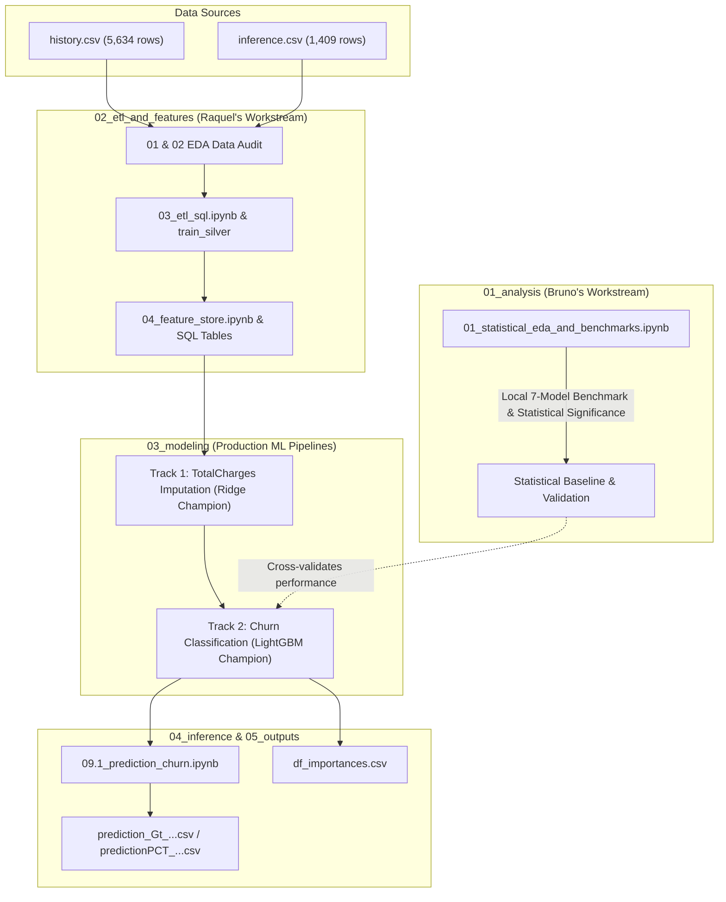

# Customer Churn Prediction & Retention System
## Equipe (Grupo 3)
- **Caroline Targino** (Madu & Carol: Databricks Dashboard & Business Layer)
- **Maria Eduarda Santos** (Madu & Carol: Databricks Dashboard & Business Layer)
- **Raquel Marques** (Databricks Pipelines, Feature Store & MLflow Champion Models)
- **Thiago Nobrega** (NLP Sentiment & Feedback Thematic Analysis)
- **Bruno Camera** (Classical Statistics, Exploratory Data Analysis & Benchmark Validation)

---

## 1. Project Overview & Context

This repository consolidates two parallel analytical workstreams for the Telecom Customer Churn Hackathon project:
1. **Classical Statistical Exploration & Local Validation Layer** (developed by Bruno).
2. **Production Delta Lake & Databricks MLflow Architecture** (developed by Raquel).

The primary goal is to predict customer churn (`TargetChurn`), impute missing accounting metrics (`TotalCharges`), score unlabelled production inference data (`inference.csv`), and output targeted retention recommendations as outlined in [ProjectPlan.md](./ProjectPlan.md).

---

## 2. Workstream Integration & Relationship



### Architectural Role of Each Workstream:
- **Leading / Primary Track (Raquel)**: Full end-to-end cloud pipeline executed in Databricks Unity Catalog, using Delta Lake tables, Feature Store SQL queries, MLflow experiment tracking, and model registration (`@champion`).
- **Validation & Statistical Layer (Bruno)**: Rigorous exploratory analysis, correlation and hypothesis testing, and single-node Scikit-Learn cross-validation benchmarks that confirm the feature dynamics and serve as an independent validation anchor.

---

## 3. Directory Layout & Navigation

```text
ORGANIZED/
├── README.md                           # Master documentation (this file)
├── ProjectPlan.md                      # Source of truth project roadmap and checklist
├── 01_analysis/                        # Bruno's Classical Statistical & Local Benchmark Layer
│   └── 01_statistical_eda_and_benchmarks.ipynb   (EDA, correlation, statistical rules, 7-model CV)
├── 02_etl_and_features/                # Data Hygiene & Unity Catalog Feature Store
│   ├── notebooks/
│   │   ├── 01_eda_data_audit_train.ipynb         (Training data profiling & churn rate deciles)
│   │   ├── 02_eda_data_audit_inference.ipynb     (Inference data drift & schema alignment)
│   │   ├── 03_etl_sql.ipynb                      (Databricks SQL hygiene & train_silver)
│   │   └── 04_feature_store.ipynb                (Delta Feature & Target Store materialization)
│   └── sql/
│       ├── feature_store.sql                     (Standardized feature transformations)
│       ├── target_store.sql                      (Target Churn and TotalCharges tables)
│       └── target_store_inference.sql            (Inference target store setup)
├── 03_modeling/                        # Databricks MLflow Modeling Workflows
│   ├── 01_totalcharges_imputer/        # Track 1: TotalCharges Missingness Imputer
│   │   ├── 05.0_abt1_totalcharges.ipynb          (ABT 1 assembly & VIF/correlation screens)
│   │   ├── 06.0_train1_totalcharges.ipynb        (OLS vs Ridge regressor training)
│   │   ├── 06.1_champion_totalcharges.ipynb      (MLflow champion imputer registration)
│   │   └── analysis_abt1_totalcharges.ipynb      (Diagnostic residual analysis)
│   └── 02_churn_classification/        # Track 2: Churn Classification Benchmarks
│       ├── 07.0_abt2_churn.ipynb                 (ABT 2 assembly with imputer model integration)
│       ├── 08.0_train2_churn.ipynb               (Benchmark of 7 ML algorithms with CV)
│       └── 08.1_champion_churn.ipynb             (Hyperparameter-tuned LightGBM champion)
├── 04_inference/                       # Scoring Engine & Deliverables
│   ├── notebooks/
│   │   ├── 09.0_abt_inference.ipynb              (Inference feature assembly)
│   │   └── 09.1_prediction_churn.ipynb           (Scoring pipeline & probability generation)
│   └── predictions/
│       ├── predictionPCT_Group3_20261112_052957.csv
│       └── prediction_Gt_20261112_052538.csv
├── 05_outputs/                         # Deliverable Artifacts & Documentation
│   ├── df_importances.csv                        (Champion model feature importances)
│   └── Notebooks_Description.md                  (Databricks notebook index and metadata)
├── 06_data/                            # Data References & Dictionaries
│   └── README.md                                 (Schema definitions, missingness patterns, paths)
└── _archive/                           # Deprecated / Historical Files
    ├── README.md                                 (Archival changelog)
    └── analise_bruno_v1.ipynb                    (Superseded 22-cell draft of Bruno's EDA)
```

---

## 4. Synthesis of EDA & Key Analytical Findings

Both workstreams conducted in-depth exploratory data analysis and reached unanimous conclusions on critical business patterns:
1. **Contract Type is the Dominant Churn Driver**:
   - Month-to-month (`M2M`) contracts exhibit ~43–50% churn rates, whereas 1-year and 2-year contracts drop churn below 11% and 3%, respectively.
2. **Tenure & Customer Vulnerability**:
   - Highest churn vulnerability occurs in the first 0–6 months of customer tenure.
3. **Paperless Billing & Payment Methods**:
   - Electronic check users churn at disproportionately higher rates compared to automatic bank transfers/credit cards.
4. **Demographic Variables Have Negligible Signal**:
   - `gender`, `SeniorCitizen`, `Partner`, and `Dependents` show minimal statistical divergence across churners vs non-churners.

---

## 5. Methodological Differences & Contradictions (Review & Reconciliation)

While both workstreams agree on the business signals, they made different technical decisions that have been reconciled as follows:

| Area | Bruno's Approach | Raquel's Approach | Contradiction / Divergence Analysis | Final Resolution & Decision |
|---|---|---|---|---|
| **Imputation of `TotalCharges`** | Deterministic business rule: `MonthlyCharges * tenure`. For `tenure == 0`, imputes with `MonthlyCharges`. | ML Imputer: Trains and registers a tuned Ridge regression model (`@champion`) inside MLflow to predict missing values. | **Divergence**: Bruno treats `TotalCharges` as roughly accumulated past billing, whereas Raquel models non-linear billing variations via regression. | **Keep Raquel's Ridge imputer for production** because it integrates seamlessly into the Databricks MLflow pipeline. Bruno's deterministic formula serves as an intuitive business baseline. |
| **Treatment of `tenure == 'unknown'`** | Explores `TotalCharges / MonthlyCharges` to infer tenure, but leaves rows without full imputation in production pipeline. | SQL Hygiene: `TRY_CAST(tenure AS BIGINT)`, cleanly converting `'unknown'` to `NULL`, followed by median imputation in modeling transformers. | **Contradiction**: Inverting tenure from `TotalCharges` risks circular dependence when both are missing or noisy. | **Raquel's `TRY_CAST` + median imputer** is safer for production scoring to prevent infinite or negative tenure estimates. |
| **Categorical Encoding** | Standard `pd.get_dummies` with `drop_first=False`, producing wide binary frames. | Custom SQL mapping + `feature_engine.encoding.OneHotEncoder(drop_last=True)` inside Scikit-Learn pipelines. | **Contradiction**: Retaining all dummy columns creates exact multicollinearity in linear models (Dummy Variable Trap). | **Raquel's approach (`drop_last=True`)** is mathematically correct for regression/linear baselines, and tree models are unaffected. |
| **`CustomerFeedback` Target Leakage** | Explicitly dropped from ABT: `ABT.drop(columns=['CustomerFeedback'])`. | Explicitly excluded from feature store and prediction notebooks. | **Full Alignment**: Both identified that `CustomerFeedback` in `inference.csv` contains post-facto cancellation comments (e.g. "decided to cancel"), which would cause target leakage. | **Strictly excluded** from all modeling and scoring. |
| **Algorithm Selection** | Evaluated 7 models; LightGBM and Logistic Regression achieved top ROC-AUC (~0.84). | Evaluated 7 models in MLflow; LightGBM achieved champion status (ROC-AUC ~0.844). | **Full Alignment**: Both independently concluded that LightGBM is the superior model. | **Consensus confirmed**: LightGBM is the definitive champion classifier. |
