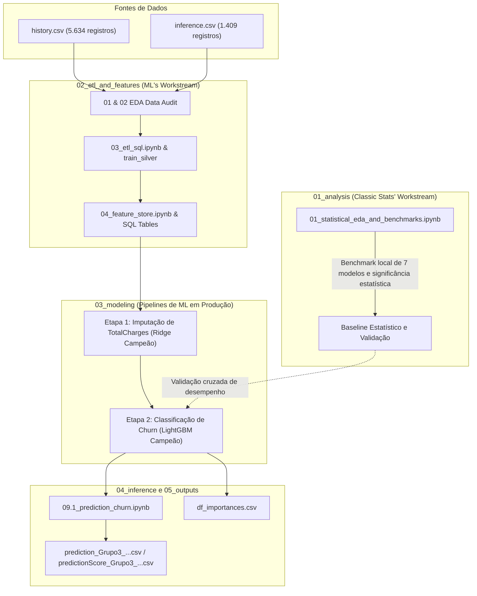

# Sistema de Previsão de Churn e Retenção de Clientes

## Equipe (Grupo 3)

- **Caroline Targino** (Madu & Carol: Dashboard no Databricks e Camada de Negócio)
- **Maria Eduarda Santos** (Madu & Carol: Dashboard no Databricks e Camada de Negócio)
- **Raquel Marques** (Pipelines no Databricks, Feature Store e Modelos Campeões no MLflow)
- **Thiago Nobrega** (Análise de Sentimentos com NLP e Análise Temática de Feedbacks)
- **Bruno Camera** (Estatística Clássica, Análise Exploratória de Dados e Validação de Benchmarks)

---

## 1. Visão Geral e Contexto do Projeto

Este repositório consolida duas frentes analíticas desenvolvidas em paralelo para o projeto **Hackathon de Previsão de Churn de Clientes de Telecomunicações**:

This repository consolidates two parallel analytical workstreams for the Telecom Customer Churn Hackathon project:
1. **Classical Statistical Exploration & Local Validation Layer**.
2. **Production Delta Lake & Databricks MLflow Architecture**.

O objetivo principal é prever o cancelamento de clientes (*churn*, representado pela variável `TargetChurn`), imputar métricas financeiras ausentes (`TotalCharges`), gerar previsões para dados de produção sem rótulos (`inference.csv`) e fornecer recomendações direcionadas de retenção, conforme estabelecido no [Plano do Projeto](./ProjectPlan.md).

---

## 2. Integração e Relação entre as Frentes de Trabalho



### Papel Arquitetural de Cada Frente de Trabalho

- **Frente Principal (Raquel):** Pipeline completo de ponta a ponta, executado em ambiente de nuvem no Databricks Unity Catalog, utilizando tabelas Delta Lake, consultas SQL para Feature Store, rastreamento de experimentos no MLflow e registro de modelos campeões (`@champion`).

- **Camada Estatística e de Validação (Bruno):** Análise exploratória rigorosa, testes de correlação e hipóteses, além de benchmarks com validação cruzada utilizando Scikit-Learn em ambiente local. Essa frente confirma os padrões identificados nas variáveis e funciona como uma referência independente para validação dos resultados.

---

## 3. Estrutura de Diretórios e Navegação

```text
./
├── README.md                                         # Documentação principal (este arquivo)
├── ProjectPlan.md                                    # Plano oficial do projeto e checklist
├── 01_analysis/                                      # Análise Estatística Clássica e Benchmarks Locais (Bruno)
│   └── 01_statistical_eda_and_benchmarks.ipynb       (EDA, correlação, regras estatísticas e validação cruzada de 7 modelos)
├── 02_etl_and_features/                              # Tratamento de Dados e Feature Store no Unity Catalog
│   ├── notebooks/
│   │   ├── 01_eda_data_audit_train.ipynb             (Perfil dos dados de treino e decis das taxas de churn)
│   │   ├── 02_eda_data_audit_inference.ipynb         (Drift nos dados de inferência e alinhamento de esquema)
│   │   ├── 03_etl_sql.ipynb                          (Tratamento de dados em SQL no Databricks e train_silver)
│   │   └── 04_feature_store.ipynb                    (Materialização das tabelas Delta de variáveis e alvos)
│   └── sql/
│       ├── feature_store.sql                         (Transformações padronizadas das variáveis)
│       ├── target_store.sql                          (Tabelas-alvo de Churn e TotalCharges)
│       └── target_store_inference.sql                (Configuração da tabela-alvo para inferência)
├── 03_modeling/                                      # Fluxos de Modelagem com Databricks e MLflow
│   ├── 01_totalcharges_imputer/                      # Etapa 1: Imputação de Valores Ausentes em TotalCharges
│   │   ├── 05.0_abt1_totalcharges.ipynb              (Construção da ABT 1 e análises de VIF/correlação)
│   │   ├── 06.0_train1_totalcharges.ipynb            (Treinamento de regressões OLS e Ridge)
│   │   ├── 06.1_champion_totalcharges.ipynb          (Registro do modelo campeão de imputação no MLflow)
│   │   └── analysis_abt1_totalcharges.ipynb          (Análise diagnóstica dos resíduos)
│   └── 02_churn_classification/                      # Etapa 2: Benchmarks de Classificação de Churn
│       ├── 07.0_abt2_churn.ipynb                     (Construção da ABT 2 com integração do modelo de imputação)
│       ├── 08.0_train2_churn.ipynb                   (Benchmark de 7 algoritmos de ML com validação cruzada)
│       └── 08.1_champion_churn.ipynb                 (Modelo campeão LightGBM com hiperparâmetros otimizados)
├── 04_inference/                                     # Motor de Predição e Entregáveis
│   ├── notebooks/
│   │   ├── 09.0_abt_inference.ipynb                  (Construção das variáveis para inferência)
│   │   └── 09.1_prediction_churn.ipynb               (Pipeline de predição e geração de probabilidades)
│   └── predictions/
│       ├── predictionScore_Group3_*.csv
│       └── prediction_Grupo3_*.csv     # Deliverable
├── 05_test_outputs/                    # Tests
│   ├── df_importances.csv                        (Champion model feature importances)
│   └── Notebooks_Description.md                  (Databricks notebook index and metadata)
├── 06_data/                            # Data References & Dictionaries
│   └── README.md                                 (Schema definitions, missingness patterns, paths)
└── _archive/                           # Deprecated / Historical Files
    ├── README.md                                 (Archival changelog)
    └── analise_bruno_v1.ipynb                    (Superseded 22-cell draft of Bruno's EDA)
```

---

## 4. Síntese da Análise Exploratória e Principais Descobertas

As duas frentes realizaram análises exploratórias aprofundadas dos dados (*Exploratory Data Analysis — EDA*) e chegaram a conclusões convergentes sobre os principais padrões de negócio.

### 4.1. O Tipo de Contrato é o Principal Fator Associado ao Churn

- Contratos mensais (`M2M`) apresentam taxas de churn entre **43% e 50%**.
- Contratos de 1 ano apresentam taxas de churn inferiores a **11%**.
- Contratos de 2 anos apresentam taxas de churn inferiores a **3%**.

Esses resultados indicam uma forte associação entre a duração do compromisso contratual e a probabilidade de cancelamento.

### 4.2. Tempo de Relacionamento e Vulnerabilidade dos Clientes

- A maior vulnerabilidade ao churn ocorre nos primeiros **0 a 6 meses** de relacionamento do cliente com a empresa.

Esse comportamento evidencia a importância de estratégias de retenção e acompanhamento durante os primeiros meses após a contratação.

### 4.3. Faturamento Digital e Métodos de Pagamento

- Clientes que utilizam cheque eletrônico apresentam taxas de churn desproporcionalmente maiores quando comparados àqueles que utilizam transferências bancárias automáticas ou cartões de crédito.

Esse padrão sugere que o método de pagamento pode funcionar como um indicador relevante de risco de cancelamento.

### 4.4. Variáveis Demográficas Apresentam Baixo Poder Preditivo

As variáveis abaixo apresentam diferenças estatísticas pouco expressivas entre clientes que cancelaram e aqueles que permaneceram ativos:

- `gender` — Gênero.
- `SeniorCitizen` — Indicador de cliente idoso.
- `Partner` — Presença de parceiro(a).
- `Dependents` — Presença de dependentes.

Os resultados indicam que essas características possuem sinal estatístico limitado quando analisadas individualmente.

---

## 5. Diferenças Metodológicas e Divergências (Revisão e Conciliação)

Embora as duas frentes concordem sobre os principais padrões de negócio, algumas decisões técnicas foram diferentes ao longo do desenvolvimento.

As divergências foram analisadas e conciliadas conforme descrito a seguir.

| Área | Abordagem Estatística | Abordagem de Machine Learning | Análise da Divergência | Resolução e Decisão Final |
|---|---|---|---|---|
| **Imputação de `TotalCharges`** | Regra determinística de negócio: `MonthlyCharges * tenure`. Quando `tenure == 0`, utiliza `MonthlyCharges` para imputação. | Modelo de imputação baseado em ML: treina e registra uma regressão Ridge otimizada (`@champion`) no MLflow para prever valores ausentes. | **Divergência:** a abordagem estatística considera `TotalCharges` como uma aproximação do faturamento acumulado, enquanto a abordagem de ML busca capturar variações no histórico de cobrança por meio de regressão. | **Manter o modelo Ridge em produção**, devido à sua integração com o pipeline Databricks e MLflow. A fórmula determinística da abordagem estatística permanece como baseline de negócio, de fácil interpretação. |
| **Tratamento de `tenure == 'unknown'`** | Investiga a relação `TotalCharges / MonthlyCharges` para estimar o tempo de relacionamento, mas não realiza a imputação completa dessas linhas no pipeline de produção. | Tratamento em SQL com `TRY_CAST(tenure AS BIGINT)`, convertendo `'unknown'` em `NULL`, seguido de imputação pela mediana nos transformadores de modelagem. | **Divergência:** calcular `tenure` a partir de `TotalCharges` pode gerar dependência circular quando ambas as variáveis estão ausentes ou contêm ruídos. | **Adotar `TRY_CAST` + imputação pela mediana**, conforme a abordagem de ML, por oferecer maior segurança na predição em produção e evitar estimativas infinitas ou negativas de tempo de relacionamento. |
| **Codificação de Variáveis Categóricas** | Utiliza `pd.get_dummies` com `drop_first=False`, gerando uma matriz ampla de variáveis binárias. | Utiliza mapeamentos SQL personalizados e `feature_engine.encoding.OneHotEncoder(drop_last=True)` dentro dos pipelines Scikit-Learn. | **Divergência:** manter todas as colunas dummy pode gerar multicolinearidade exata em modelos lineares (*Dummy Variable Trap*). | **Adotar a abordagem de ML (`drop_last=True`)**, matematicamente adequada para regressões e baselines lineares. Modelos baseados em árvores não são afetados da mesma maneira. |
| **Vazamento da Variável-Alvo em `CustomerFeedback`** | Remove explicitamente a variável da ABT por meio de `ABT.drop(columns=['CustomerFeedback'])`. | Exclui explicitamente a variável da Feature Store e dos notebooks de predição. | **Alinhamento total:** ambas as frentes identificaram que `CustomerFeedback`, em `inference.csv`, contém comentários posteriores à decisão de cancelamento, como "decidiu cancelar", o que provocaria vazamento da variável-alvo (*target leakage*). | **Excluir rigorosamente `CustomerFeedback`** de todas as etapas de modelagem e geração de previsões. |
| **Seleção de Algoritmos** | Avaliou 7 modelos; LightGBM e Regressão Logística apresentaram os melhores resultados de ROC-AUC (aproximadamente 0,84). | Avaliou 7 modelos utilizando MLflow; LightGBM foi selecionado como campeão, com ROC-AUC de aproximadamente 0,844. | **Alinhamento total:** ambas as frentes concluíram, de forma independente, que LightGBM apresentou o melhor desempenho. | **Consenso confirmado:** LightGBM é o classificador campeão definitivo do projeto. |
