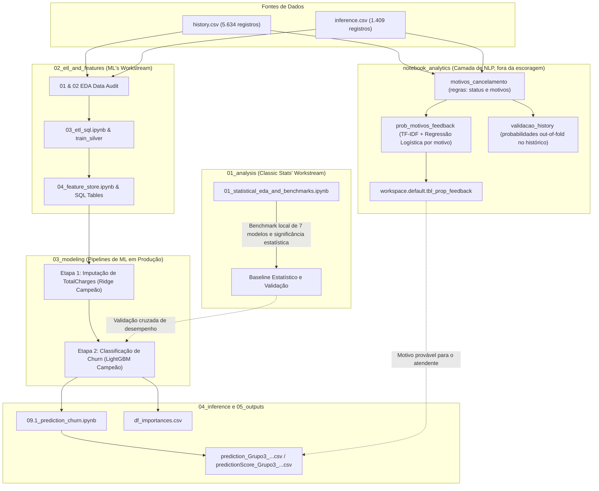

# Sistema de Previsão de Churn e Retenção de Clientes

## Equipe (Grupo 3)

- **Caroline Targino** (Madu & Carol: Dashboard no Databricks e Camada de Negócio)
- **Maria Eduarda Santos** (Madu & Carol: Dashboard no Databricks e Camada de Negócio)
- **Raquel Marques** (Pipelines no Databricks, Feature Store e Modelos Campeões no MLflow)
- **Thiago Nobrega** (Análise de Sentimentos com NLP e Análise Temática de Feedbacks)
- **Bruno Camera** (Estatística Clássica, Análise Exploratória de Dados e Validação de Benchmarks)

---

## 1. Visão Geral e Contexto do Projeto

Este repositório consolida três frentes analíticas desenvolvidas em paralelo para o projeto **Hackathon de Previsão de Churn de Clientes de Telecomunicações**:

This repository consolidates three parallel analytical workstreams for the Telecom Customer Churn Hackathon project:
1. **Classical Statistical Exploration & Local Validation Layer**.
2. **Production Delta Lake & Databricks MLflow Architecture**.
3. **Camada de NLP de apoio ao operador** (`notebook_analytics/`): identifica no `CustomerFeedback` o motivo de insatisfação de cada cliente, fora do modelo de escoragem.

O objetivo principal é prever o cancelamento de clientes (*churn*, representado pela variável `TargetChurn`), imputar métricas financeiras ausentes (`TotalCharges`), gerar previsões para dados de produção sem rótulos (`inference.csv`) e fornecer recomendações direcionadas de retenção, conforme estabelecido no [Plano do Projeto](./ProjectPlan.md).

---

## 2. Integração e Relação entre as Frentes de Trabalho



### Papel Arquitetural de Cada Frente de Trabalho

- **Frente Principal (Raquel):** Pipeline completo de ponta a ponta, executado em ambiente de nuvem no Databricks Unity Catalog, utilizando tabelas Delta Lake, consultas SQL para Feature Store, rastreamento de experimentos no MLflow e registro de modelos campeões (`@champion`).

- **Camada Estatística e de Validação (Bruno):** Análise exploratória rigorosa, testes de correlação e hipóteses, além de benchmarks com validação cruzada utilizando Scikit-Learn em ambiente local. Essa frente confirma os padrões identificados nas variáveis e funciona como uma referência independente para validação dos resultados.

- **Camada de NLP de Feedbacks (Thiago):** Lê o `CustomerFeedback` e devolve, para cada cliente, uma probabilidade por motivo de insatisfação (preço, concorrente, forma de pagamento e técnico), junto com o trecho do texto que a sustenta. **Não alimenta o modelo de churn**: é uma camada de apoio para o atendente saber por onde começar a conversa. Detalhes na seção 6.

---

## 3. Estrutura de Diretórios e Navegação

```text
./
├── README.md                                         # Documentação principal (este arquivo)
├── ProjectPlan.md                                    # Plano oficial do projeto e checklist
├── 01_analysis/                                      # Análise Estatística Clássica e Benchmarks Locais (Bruno)
│   └── 01_statistical_eda_and_benchmarks.ipynb       (EDA, correlação, regras estatísticas e validação cruzada de 7 modelos)
├── 02_etl_and_features/                              # Tratamento de Dados e Feature Store no Unity Catalog
│   ├── notebooks/
│   │   ├── 01_eda_data_audit_train.ipynb             (Perfil dos dados de treino e decis das taxas de churn)
│   │   ├── 02_eda_data_audit_inference.ipynb         (Drift nos dados de inferência e alinhamento de esquema)
│   │   ├── 03_etl_sql.ipynb                          (Tratamento de dados em SQL no Databricks e train_silver)
│   │   └── 04_feature_store.ipynb                    (Materialização das tabelas Delta de variáveis e alvos)
│   └── sql/
│       ├── feature_store.sql                         (Transformações padronizadas das variáveis)
│       ├── target_store.sql                          (Tabelas-alvo de Churn e TotalCharges)
│       └── target_store_inference.sql                (Configuração da tabela-alvo para inferência)
├── 03_modeling/                                      # Fluxos de Modelagem com Databricks e MLflow
│   ├── 01_totalcharges_imputer/                      # Etapa 1: Imputação de Valores Ausentes em TotalCharges
│   │   ├── 05.0_abt1_totalcharges.ipynb              (Construção da ABT 1 e análises de VIF/correlação)
│   │   ├── 06.0_train1_totalcharges.ipynb            (Treinamento de regressões OLS e Ridge)
│   │   ├── 06.1_champion_totalcharges.ipynb          (Registro do modelo campeão de imputação no MLflow)
│   │   └── analysis_abt1_totalcharges.ipynb          (Análise diagnóstica dos resíduos)
│   └── 02_churn_classification/                      # Etapa 2: Benchmarks de Classificação de Churn
│       ├── 07.0_abt2_churn.ipynb                     (Construção da ABT 2 com integração do modelo de imputação)
│       ├── 08.0_train2_churn.ipynb                   (Benchmark de 7 algoritmos de ML com validação cruzada)
│       └── 08.1_champion_churn.ipynb                 (Modelo campeão LightGBM com hiperparâmetros otimizados)
├── 04_inference/                                     # Motor de Predição e Entregáveis
│   ├── notebooks/
│   │   ├── 09.0_abt_inference.ipynb                  (Construção das variáveis para inferência)
│   │   └── 09.1_prediction_churn.ipynb               (Pipeline de predição e geração de probabilidades)
│   └── predictions/
│       ├── predictionScore_Group3_*.csv
│       └── prediction_Grupo3_*.csv     # Deliverable
├── 05_test_outputs/                    # Tests
│   ├── df_importances.csv                        (Champion model feature importances)
│   └── Notebooks_Description.md                  (Databricks notebook index and metadata)
├── 06_data/                            # Data References & Dictionaries
│   └── README.md                                 (Schema definitions, missingness patterns, paths)
├── 07_sentiment_analysis/              # Análise de Sentimentos e NLP sobre CustomerFeedback (Thiago)
│   ├── validacao_history.py                      (Validação cruzada out-of-fold no histórico)
│   └── notebook_analytics/                       (Rotinas de regras, modelos TF-IDF e documentação técnica)
│       ├── motivos_cancelamento.py               (Regras lexicais: status, motivos e extração de trechos)
│       ├── prob_motivos_feedback.py              (4 modelos TF-IDF + Regressão Logística para escoragem de texto)
│       ├── abt_feedback.py                       (Análise exploratória de TF-IDF e sentimento)
│       ├── modelos_motivos.py                    (Exploratório: relacionamento entre variáveis tabulares e motivos)
│       └── Analise_Exploratoria.ipynb            (Notebook de exploração textual e validações)
├── 08_churn_motive/                    # Modelagem Preditiva de Motivos de Churn & SHAP Explainability
│   ├── 20.0_analysis_motives.ipynb               (Análise diagnóstica e regressões com interpretabilidade SHAP)
│   ├── 20.1_shap_motives.ipynb                   (Treinamento e registro dos 4 regressores LightGBM no MLflow)
│   ├── 21.0_score_churn_motives.ipynb            (Escoragem dos 4 motivos via modelos campeões em workspace.default.churn_motives)
│   ├── manual_testing_view.ipynb                 (Visualização e testes manuais da tabela consolidada)
│   └── prob_*_feature_importance.csv             (Importância e drivers de cada motivo extraídos via SHAP)
└── _archive/                           # Deprecated / Historical Files
    ├── README.md                                 (Archival changelog)
    └── analise_bruno_v1.ipynb                    (Superseded 22-cell draft of Bruno's EDA)
```

---

## 4. Síntese da Análise Exploratória e Principais Descobertas

As duas frentes realizaram análises exploratórias aprofundadas dos dados (*Exploratory Data Analysis — EDA*) e chegaram a conclusões convergentes sobre os principais padrões de negócio.

### 4.1. O Tipo de Contrato é o Principal Fator Associado ao Churn

- Contratos mensais (`M2M`) apresentam taxas de churn entre **43% e 50%**.
- Contratos de 1 ano apresentam taxas de churn inferiores a **11%**.
- Contratos de 2 anos apresentam taxas de churn inferiores a **3%**.

Esses resultados indicam uma forte associação entre a duração do compromisso contratual e a probabilidade de cancelamento.

### 4.2. Tempo de Relacionamento e Vulnerabilidade dos Clientes

- A maior vulnerabilidade ao churn ocorre nos primeiros **0 a 6 meses** de relacionamento do cliente com a empresa.

Esse comportamento evidencia a importância de estratégias de retenção e acompanhamento durante os primeiros meses após a contratação.

### 4.3. Faturamento Digital e Métodos de Pagamento

- Clientes que utilizam cheque eletrônico apresentam taxas de churn desproporcionalmente maiores quando comparados àqueles que utilizam transferências bancárias automáticas ou cartões de crédito.

Esse padrão sugere que o método de pagamento pode funcionar como um indicador relevante de risco de cancelamento.

### 4.4. Variáveis Demográficas Apresentam Baixo Poder Preditivo

As variáveis abaixo apresentam diferenças estatísticas pouco expressivas entre clientes que cancelaram e aqueles que permaneceram ativos:

- `gender` — Gênero.
- `SeniorCitizen` — Indicador de cliente idoso.
- `Partner` — Presença de parceiro(a).
- `Dependents` — Presença de dependentes.

Os resultados indicam que essas características possuem sinal estatístico limitado quando analisadas individualmente.

---

## 5. Diferenças Metodológicas e Divergências (Revisão e Conciliação)

Embora as duas frentes concordem sobre os principais padrões de negócio, algumas decisões técnicas foram diferentes ao longo do desenvolvimento.

As divergências foram analisadas e conciliadas conforme descrito a seguir.

| Área | Abordagem Estatística | Abordagem de Machine Learning | Análise da Divergência | Resolução e Decisão Final |
|---|---|---|---|---|
| **Imputação de `TotalCharges`** | Regra determinística de negócio: `MonthlyCharges * tenure`. Quando `tenure == 0`, utiliza `MonthlyCharges` para imputação. | Modelo de imputação baseado em ML: treina e registra uma regressão Ridge otimizada (`@champion`) no MLflow para prever valores ausentes. | **Divergência:** a abordagem estatística considera `TotalCharges` como uma aproximação do faturamento acumulado, enquanto a abordagem de ML busca capturar variações no histórico de cobrança por meio de regressão. | **Manter o modelo Ridge em produção**, devido à sua integração com o pipeline Databricks e MLflow. A fórmula determinística da abordagem estatística permanece como baseline de negócio, de fácil interpretação. |
| **Tratamento de `tenure == 'unknown'`** | Investiga a relação `TotalCharges / MonthlyCharges` para estimar o tempo de relacionamento, mas não realiza a imputação completa dessas linhas no pipeline de produção. | Tratamento em SQL com `TRY_CAST(tenure AS BIGINT)`, convertendo `'unknown'` em `NULL`, seguido de imputação pela mediana nos transformadores de modelagem. | **Divergência:** calcular `tenure` a partir de `TotalCharges` pode gerar dependência circular quando ambas as variáveis estão ausentes ou contêm ruídos. | **Adotar `TRY_CAST` + imputação pela mediana**, conforme a abordagem de ML, por oferecer maior segurança na predição em produção e evitar estimativas infinitas ou negativas de tempo de relacionamento. |
| **Codificação de Variáveis Categóricas** | Utiliza `pd.get_dummies` com `drop_first=False`, gerando uma matriz ampla de variáveis binárias. | Utiliza mapeamentos SQL personalizados e `feature_engine.encoding.OneHotEncoder(drop_last=True)` dentro dos pipelines Scikit-Learn. | **Divergência:** manter todas as colunas dummy pode gerar multicolinearidade exata em modelos lineares (*Dummy Variable Trap*). | **Adotar a abordagem de ML (`drop_last=True`)**, matematicamente adequada para regressões e baselines lineares. Modelos baseados em árvores não são afetados da mesma maneira. |
| **Vazamento da Variável-Alvo em `CustomerFeedback`** | Remove explicitamente a variável da ABT por meio de `ABT.drop(columns=['CustomerFeedback'])`. | Exclui explicitamente a variável da Feature Store e dos notebooks de predição. | **Alinhamento total:** ambas as frentes identificaram que `CustomerFeedback`, em `inference.csv`, contém comentários posteriores à decisão de cancelamento, como "decidiu cancelar", o que provocaria vazamento da variável-alvo (*target leakage*). | **Excluir rigorosamente `CustomerFeedback`** de todas as etapas de modelagem e geração de previsões. O texto é usado apenas na camada de apoio ao operador (`notebook_analytics/`, seção 6), que não alimenta o modelo de churn. |
| **Seleção de Algoritmos** | Avaliou 7 modelos; LightGBM e Regressão Logística apresentaram os melhores resultados de ROC-AUC (aproximadamente 0,84). | Avaliou 7 modelos utilizando MLflow; LightGBM foi selecionado como campeão, com ROC-AUC de aproximadamente 0,844. | **Alinhamento total:** ambas as frentes concluíram, de forma independente, que LightGBM apresentou o melhor desempenho. | **Consenso confirmado:** LightGBM é o classificador campeão definitivo do projeto. |

---

## 6. Camada de NLP: Motivos de Cancelamento no `CustomerFeedback`

### 6.1. Objetivo e Relação com o Modelo de Churn

O `CustomerFeedback` não pode entrar no modelo de churn: no histórico, 1.498 dos 1.504 clientes que cancelaram escrevem no texto que decidiram sair (vazamento da variável-alvo, seção 5). Ainda assim, o texto diz **por que** o cliente está insatisfeito.

Esta camada transforma o feedback em uma **probabilidade por motivo**, entregue ao atendente junto com o score do modelo de churn. Ela não altera nem alimenta a escoragem.

### 6.2. Como Funciona

1. **Regras leem o texto** (`motivos_cancelamento`). O texto é dividido em trechos (frases e cortes em *but*, *however*, *while*). Um motivo só é marcado quando o mesmo trecho fala do assunto **e** reclama dele. Ex.: *"the monthly charges were too high"* = preço; *"charges were reasonable"* não conta. As regras também classificam o `status_texto` (declarou saída, insatisfeito, satisfeito).
2. **As regras viram gabarito.** Cada cliente do histórico recebe 0 ou 1 em quatro motivos: `preco`, `concorrente`, `pagamento` e `tecnico` (instabilidade, velocidade ou falta de conexão).
3. **Um modelo por motivo** (`prob_motivos_feedback`). TF-IDF (n-gramas de 1 a 3) + Regressão Logística com `class_weight="balanced"`. Palavras de decisão (*decided*, *churn*, *cancel*, *switch*...) são removidas do vocabulário, para o modelo aprender a queixa e não a decisão de sair.
4. **Validação cruzada** (`StratifiedKFold`, 5 dobras). Cada cliente do histórico recebe a nota de um modelo que não viu o seu texto no treino (*out-of-fold*).
5. **Escoragem do inference.** Os modelos treinados em todo o histórico geram `prob_preco`, `prob_concorrente`, `prob_pagamento`, `prob_tecnico`, `motivo_mais_provavel`, `prob_maxima`, `status_texto` e `trecho_evidencia`, gravados em `workspace.default.tbl_prop_feedback`.

### 6.3. Ordem de Execução

| Ordem | Notebook | Entrada | Saída |
|---|---|---|---|
| 1 | `motivos_cancelamento` | `history.csv`, `inference.csv` | Função `processar()` e colunas de status e motivos |
| 2 | `prob_motivos_feedback` | `history.csv`, `inference.csv` | `workspace.default.tbl_prop_feedback` (inference) |
| 3 | `validacao_history` | `history.csv` | Métricas de validação e `saida_hist` (probabilidades out-of-fold do histórico) |

Os três notebooks trazem as regras embutidas e leem os CSVs com `multiLine=true` e `escape='"'`, obrigatórios porque o feedback contém quebras de linha. `abt_feedback` e `modelos_motivos` são registros exploratórios e não fazem parte do fluxo final.

### 6.4. Resultados no Histórico (5.634 clientes)

Validação cruzada, probabilidade comparada ao gabarito das regras:

| Motivo | Textos com o motivo | AUC | Precisão (p > 0,5) | Cobertura (p > 0,5) |
|---|---|---|---|---|
| Preço | 807 | 0,987 | 0,85 | 0,92 |
| Concorrente | 574 | 0,998 | 0,86 | 0,98 |
| Pagamento | 541 | 0,993 | 0,91 | 0,95 |
| Técnico | 872 | 0,981 | 0,79 | 0,92 |

Entre os 1.504 clientes que cancelaram, com probabilidade acima de 0,7:

| Motivo | Clientes | % dos churners | Perfil |
|---|---|---|---|
| Técnico | 837 | 56% | Clientes novos, mediana de 5 meses de casa |
| Concorrente | 579 | 38% | Citam oferta melhor ou mais barata |
| Preço | 563 | 37% | 87% fibra, mensalidade mediana de US$ 90 |
| Pagamento | 452 | 30% | 98% pagam com cheque |

- 91% dos churners (1.367) têm pelo menos um motivo identificado.
- 50,5% citam dois ou mais motivos, por isso os percentuais somam mais de 100%.
- Entre os 4.130 clientes que **não** cancelaram, 227 já mostram uma queixa (162 de preço, 60 de pagamento, 20 técnica). Concorrente não aparece nesse grupo: o tema só surge depois da decisão de sair.

### 6.5. Limitações

- **O modelo imita as regras.** As métricas medem a concordância com o gabarito das regras, não com um motivo validado por pessoas. Recomenda-se revisar manualmente uma amostra de ~30 clientes.
- **Textos padronizados.** Os feedbacks desta base seguem um padrão muito regular. Comentários reais, mais curtos e informais, exigiriam revisar as listas de palavras.
- **Momento do feedback.** Não se sabe se o texto é escrito antes ou depois do cancelamento. Se for sempre depois, a camada perde o caráter preventivo e serve apenas para diagnóstico.

---

## 7. Da Análise Textual à Ação de Negócio: Modelagem de Motivos e Interpretabilidade (`07_*` e `08_*`)

Enquanto a **Seção 6** detalha a extração linguística a partir do `CustomerFeedback`, as pastas `07_sentiment_analysis/` e `08_churn_motive/` fecham o ciclo analítico respondendo à pergunta crítica de negócio: **como associar o perfil cadastral e de consumo do cliente aos motivos de insatisfação revelados pelo texto?**

### 7.1. Conexão entre o Texto e os Dados Estruturados

A camada de NLP gera a tabela `workspace.default.tbl_prop_feedback`, contendo as probabilidades de cada um dos quatro motivos (`prob_preco`, `prob_concorrente`, `prob_pagamento`, `prob_tecnico`) para os clientes com feedback disponível. 

Na pasta `08_churn_motive/`, essas probabilidades são cruzadas com as variáveis comportamentais da ABT (`raw_abt2_churn`) para treinar modelos preditivos baseados exclusivamente nas variáveis tabulares de cadastro e serviços. Isso permite que a operação estime a propensão a cada motivo mesmo para clientes futuros ou em cenários onde não haja texto preenchido.

### 7.2. Pipeline de Modelagem de Motivos (`08_churn_motive/`)

1. **Análise Diagnóstica e SHAP (`20.0_analysis_motives.ipynb` e `20.1_shap_motives.ipynb`):**
   - Treinamento de 4 regressores supervisionados LightGBM (um para cada motivo) utilizando 37 variáveis comportamentais e cadastrais (excluindo qualquer dado textual para evitar vazamento).
   - Rastreamento dos experimentos e registro dos modelos no MLflow sob o namespace `workspace.default.motive_<motivo>@champion`.
   - Utilização de valores de SHAP (*SHapley Additive exPlanations*) e gráficos *waterfall* para isolar o "DNA" de cada motivo de cancelamento.

2. **Escoragem em Lote de Motivos (`21.0_score_churn_motives.ipynb`):**
   - Execução pós-escoragem de churn (`10.0_batch_score_churn`).
   - Aplica os quatro modelos campeões de motivos sobre toda a base escorada, persistindo as probabilidades resultantes na tabela Delta `workspace.default.churn_motives`.
   - Controle de proveniência com hash seguro (`feature_digest`) e registro de data (`scored_at`), garantindo reprocessamento apenas quando as variáveis do cliente sofrerem alteração.

### 7.3. Principais Drivers por Motivo (Interpretação de Negócio via SHAP)

A análise com SHAP revelou padrões bem delimitados para cada insatisfação:

- **Preço (`prob_preco`):** Fortemente impulsionado por `MonthlyCharges`, `TotalSpendPct` e `chargesPerService`. Clientes com pacotes de fibra óptica e mensalidades elevadas concentram essa queixa.
- **Concorrente (`prob_concorrente`):** Associado a clientes com contratos mensais (`M2M`), ausência de serviços agregados de segurança/suporte e maior sensibilidade a ofertas do mercado.
- **Pagamento (`prob_pagamento`):** Altamente correlacionado a faturamento em cheque eletrônico (`isPaymentMethod_ElectronicCheck`) e modalidades manuais de pagamento.
- **Técnico (`prob_tecnico`):** Concentrado em clientes de início de relacionamento (`nbrTenure` baixo), com problemas recorrentes de suporte nos primeiros meses de ativação.

Essas estimativas alimentam diretamente as ferramentas de suporte ao operador e dashboards, permitindo ações proativas de retenção direcionadas à raiz do problema.
